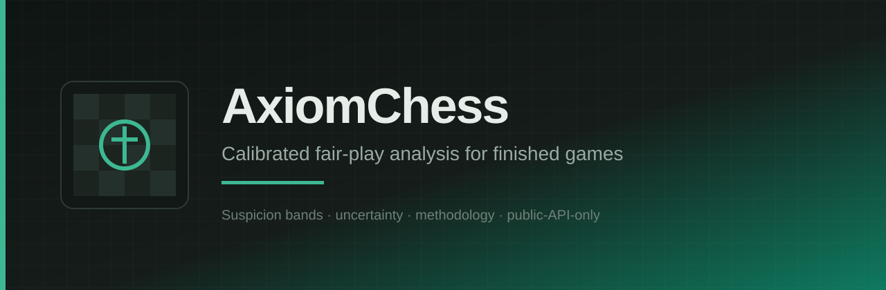

<p align="center">
  
</p>

<p align="center">
  
</p>

# .github

Org templates, shared Actions, and the **organization homepage** profile for AxiomChess.

Language: English only. No emoji. Finished games only.

## Organization homepage

GitHub renders [`profile/README.md`](./profile/README.md) on:

**https://github.com/AxiomChess**

Open that URL (the organization overview), not only this repository file list. Hard-refresh if the banner looks cached.

Brand assets: `profile/assets/` (banner + logo).

## Contents

| Path | Purpose |
| --- | --- |
| `profile/README.md` | Org homepage content |
| `profile/assets/` | Banner and logo SVGs |
| `.github/ISSUE_TEMPLATE/` | Default bug and feature forms |
| `.github/PULL_REQUEST_TEMPLATE.md` | Default PR checklist |
| `actions/lint-placeholder/` | Shared composite action stub |
| `workflow-templates/lint-placeholder.yml` | Org workflow template |
| `docs/CODEOWNERS.md` | CODEOWNERS guidance for product repos |

## Shared action usage

```yaml
jobs:
  lint:
    runs-on: ubuntu-latest
    steps:
      - uses: actions/checkout@v4
      - uses: AxiomChess/.github/actions/lint-placeholder@main
```

## License

MIT. See `LICENSE`.
