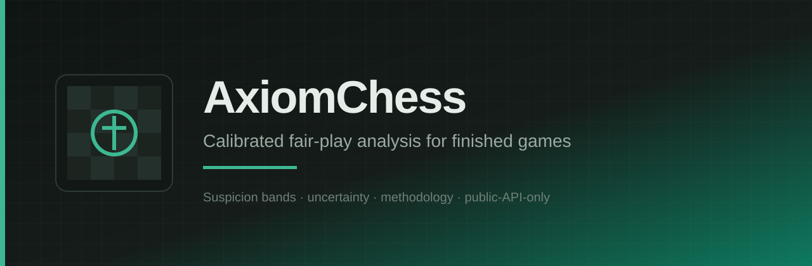

  

  <strong>Calibrated fair-play analysis for finished games</strong> 
  Engine-backed reports with suspicion bands, uncertainty, and methodology notes -- never a raw accusation.

  <a href="https://axiomchess.github.io/docs/">Product wiki</a>
  &nbsp;·&nbsp;
  <a href="https://axiomchess.github.io/docs/getting-started.html">Getting started</a>
  &nbsp;·&nbsp;
  <a href="https://axiomchess.github.io/docs/methodology.html">Methodology</a>
  &nbsp;·&nbsp;
  <a href="https://axiomchess.github.io/docs/api-overview.html">API reference</a>

---

## Repositories

| Repository | Role |
| --- | --- |
| [web](https://github.com/AxiomChess/web) | Marketing site, analyze UI, report pages (Next.js) |
| [api](https://github.com/AxiomChess/api) | Public HTTP API (Hono), quotas, jobs, Postgres |
| [analyzer](https://github.com/AxiomChess/analyzer) | Stockfish workers, features, calibrated scoring |
| [adapters](https://github.com/AxiomChess/adapters) | Lichess + Chess.com public ingest, PGN normalize |
| [design](https://github.com/AxiomChess/design) | Ink and Felt tokens, board theme, brand assets |
| [docs](https://github.com/AxiomChess/docs) | Product docs on GitHub Pages |
| [.github](https://github.com/AxiomChess/.github) | Org templates, shared Actions, this profile |

## Direction

Ink and Felt: cool chalk surfaces, one emerald felt accent, chess-native boards. English only. No emoji. MIT first-party code.

## Hard limits

- Public-API-only ingest (Lichess + Chess.com Published Data)
- Suspicion bands only: `low` | `elevated` | `high` | `inconclusive`
- Never a definitive "cheater" label
